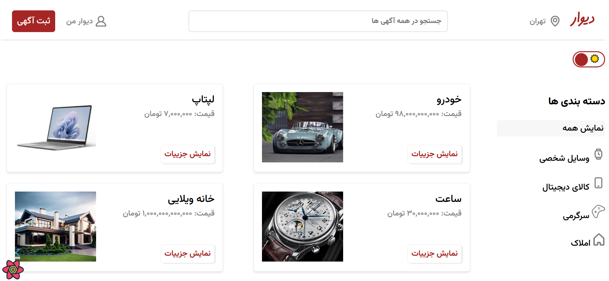

# Divar-Web

A responsive online classifieds platform inspired by Divar, built with React.

**Live Demo:** [Divar-Web](https://divar-web.vercel.app)

## Preview



## Features

- Browse and view advertisements
- Create and publish new ads
- Search by keywords and categories
- User authentication with OTP
- User dashboard
- Admin panel for managing ads and categories
- Responsive design
- Dark and light themes

## Technologies Used

**Frontend:**
- React.js
- JavaScript
- HTML5 & CSS3
- React Router DOM
- TanStack React Query
- Axios
- React Hot Toast

**Backend:**
- Node.js & Express.js
- MongoDB & Mongoose
- JWT Authentication

## Repositories

- [Frontend](https://github.com/Mobina-Karimi/Divar-Web)
- [Backend](https://github.com/Mobina-Karimi/Divar-Web-Backend)

## Installation

```bash
git clone https://github.com/Mobina-Karimi/Divar-Web.git
cd Divar-Web
npm install
```

Create a `.env` file in the frontend root:

```env
VITE_BASE_URL=YOUR_BACKEND_API_URL
```

Run the development server:

```bash
npm run dev
```

## Deployment

- Frontend: [Vercel](https://vercel.com)
- Backend: [Render](https://render.com)

## Note

OTP authentication is implemented, but real SMS delivery through an external SMS gateway is not currently integrated.

## Author

**Mobina Karimi**

[GitHub](https://github.com/Mobina-Karimi)
